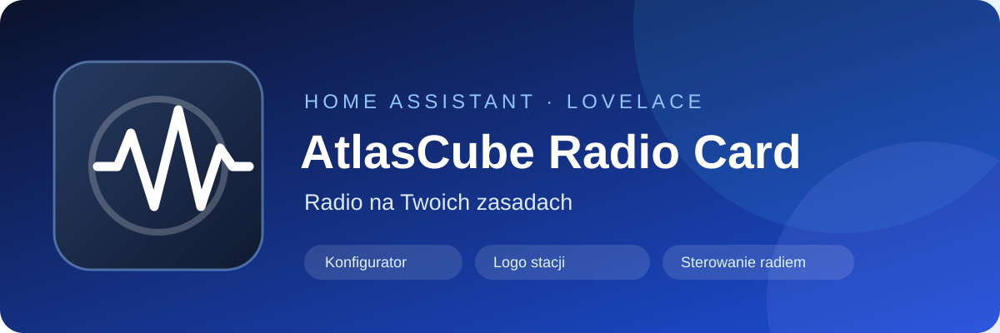

# AtlasCube Radio Card



<p align="center">
  <strong>Nowoczesna karta radia AtlasCube dla Home Assistant</strong><br>
  Sterowanie radiem, logo stacji, okładki utworów i automatyczna konfiguracja.
</p>

<p align="center">
  
  
  
  
</p>

---

## 🇵🇱 Polski

AtlasCube Radio Card to karta Lovelace połączona z integracją Home Assistant. Zapewnia wygodne sterowanie radiem AtlasCube oraz automatyczną obsługę logo stacji i okładek aktualnie odtwarzanych utworów.

Wersja **0.5.9** łączy kartę i integrację w jednym oficjalnym repozytorium. Integracja udostępnia plik JavaScript karty, rejestruje go w Lovelace i obsługuje lokalną bibliotekę logo oraz cache okładek. Nie trzeba ręcznie dodawać zasobu JavaScript.

### ✨ Najważniejsze funkcje

| Funkcja | Opis |
|---|---|
| 🔎 Automatyczne wykrywanie | Karta odczytuje rejestry urządzeń i encji Home Assistant, aby znaleźć AtlasCube i uzupełnić konfigurację |
| ⏮️ Sterowanie radiem | Poprzednia stacja/utwór, Play, Stop i Następna |
| 🔊 Głośność | Suwak głośności z bieżącą wartością i ikoną wyciszenia |
| 📻 Źródło | Wybór źródła odtwarzania na podstawie opcji udostępnianych przez encję |
| 🖼️ Okładki utworów | Automatyczne wyszukiwanie okładki na podstawie wykonawcy i tytułu |
| 🏷️ Logo stacji | Automatyczne wyszukiwanie logo oraz wyświetlanie go obok nazwy stacji |
| 💾 Lokalna biblioteka logo | Wybrane logo jest zapisywane na dysku Home Assistant i ponownie wykorzystywane |
| 🎯 Ręczny wybór logo | Kliknięcie logo lub nazwy stacji otwiera panel dostępnych propozycji |
| ↻ Odświeżanie logo | Możliwość ponownego pobrania zapisanego logo |
| ♻️ Wybór automatyczny | Możliwość przywrócenia automatycznego wyboru logo |
| 🌐 Online / offline | Karta rozpoznaje niedostępność AtlasCube na podstawie stanów jego natywnych encji |
| 🔗 Panel WWW | Kliknięcie nagłówka otwiera interfejs WWW urządzenia, jeśli Home Assistant udostępnia jego adres |
| ⚙️ Widoczność sekcji | Można niezależnie ukryć okładki, logo stacji, źródło, oznaczenie źródła logo i głośność |

### 📻 Sterowanie i wygląd karty

Karta prezentuje nazwę aktualnej stacji, jej logo, informacje o odtwarzanym utworze oraz elementy sterowania. Wygląd dostosowuje się do stanu radia:

- **Online i odtwarzanie** — widoczne są informacje o utworze i okładka, jeśli ta funkcja jest włączona.
- **Online i zatrzymane** — karta pozostaje w kompaktowym widoku sterowania.
- **Offline / niedostępne** — karta pokazuje czytelny wskaźnik braku połączenia.
- **Bez okładek** — można używać kompaktowego widoku z animowaną ikoną radia podczas odtwarzania.

Logo stacji może mieć oznaczenie źródła:
- **💾 DYSK** — logo pochodzi z lokalnej biblioteki Home Assistant.
- **🌐 ONLINE** — logo zostało pobrane ze źródła internetowego.

### 🏷️ Logo stacji — wyszukiwanie i wybór

Karta korzysta z nazwy stacji oraz — jeśli jest dostępny — adresu strumienia AtlasCube. Algorytm sprawdza dopasowanie do stacji, ogranicza ryzyko wybrania podobnej, ale innej rozgłośni i korzysta z kilku źródeł wyników.

Wyszukiwanie obejmuje m.in.:
1. Dopasowanie stacji po adresie strumienia w Radio Browser.
2. Dopasowanie dokładnej nazwy w Radio Browser.
3. Wyszukiwanie alternatywnych zapisów nazwy stacji.
4. Dodatkowe źródło Wikimedia Commons.

Kolejność propozycji w panelu wyboru jest ustalona przez algorytm. Kliknięcie wybranej propozycji zapisuje logo w lokalnej bibliotece. Można też odświeżyć zapisane logo albo przywrócić wybór automatyczny.

Lokalne pliki logo są przechowywane w:

`/config/www/atlascube-radio-station-logos/`

i udostępniane w Home Assistant przez ścieżkę:

`/local/atlascube-radio-station-logos/`

### 🖼️ Okładki utworów — Jarvis i dashboard

Integracja śledzi encję tytułu utworu:

`sensor.atlascube_radio_tytul_utworu`

Na podstawie metadanych wykonawcy i tytułu wyszukuje okładkę w iTunes, a następnie zapisuje dwie niezależne wersje obrazu:

| Wersja | Rozmiar | Zastosowanie | Udostępnienie |
|---|---:|---|---|
| Lekka | **120 × 120 px** | ESP32-CYD / Jarvis | Stan encji `sensor.atlascube_radio_cover_url` |
| Duża | **1200 × 1200 px** | Karta Lovelace / dashboard | Atrybut `artwork_large` tej samej encji |

Obie wersje mają osobne katalogi cache. Karta dashboardu korzysta z dużej okładki, a Jarvis może pobierać lekką wersję bez konieczności przetwarzania dużego obrazu na ESP32.

Katalogi cache:

- `/config/www/atlascube-radio-covers/`
- `/config/www/atlascube-radio-covers-large/`

Integracja ogranicza liczbę przechowywanych plików i ponownie wykorzystuje zapisane okładki dla wcześniej odtwarzanych utworów.

### 📡 Dostępność MQTT — bez dodatkowego sensora ping

AtlasCube przekazuje dostępność przez MQTT, a Home Assistant uwzględnia ją w stanach natywnych encji urządzenia.

Karta domyślnie korzysta z tych stanów:
- prawidłowy stan encji — urządzenie jest traktowane jako dostępne,
- `unavailable` lub `unknown` — urządzenie jest traktowane jako niedostępne.

Nie jest wymagany osobny `binary_sensor` sprawdzający ping urządzenia. Pole **Dostępność** w konfiguratorze pozostaje opcjonalnym, ręcznym nadpisaniem tej logiki.

### 🌐 Otwieranie panelu WWW AtlasCube

Karta odczytuje adres `configuration_url` z rejestru urządzeń Home Assistant na podstawie przypisanych encji. Kliknięcie nagłówka karty otwiera panel WWW AtlasCube.

Nie trzeba wpisywać adresu IP ręcznie, o ile urządzenie ma poprawnie ustawiony adres w Home Assistant.

### 📦 Wymagania

- Home Assistant.
- Radio AtlasCube skonfigurowane w Home Assistant.
- Encje radia dostępne w Home Assistant — standardowo przez integrację MQTT.
- HACS (zalecany sposób instalacji).

### 🚀 Instalacja przez HACS

Repozytorium należy instalować jako **Integration**, a nie jako Dashboard.

1. Otwórz **HACS**.
2. Wejdź w menu **⋮ → Repozytoria niestandardowe**.
3. Dodaj adres:
   `https://github.com/MarLip1981/atlascube-radio-card`
4. Wybierz kategorię **Integration**.
5. Zainstaluj **AtlasCube Radio Card**.
6. Uruchom ponownie Home Assistant.
7. Otwórz **Ustawienia → Urządzenia i usługi → Dodaj integrację**.
8. Wyszukaj i dodaj **AtlasCube Local Logos**.
9. Otwórz dashboard i dodaj kartę **AtlasCube Radio Card**.

**Ważne przy migracji:** jeśli to repozytorium było wcześniej dodane w HACS jako **Dashboard**, usuń stary wpis przed dodaniem go jako **Integration**. Nie instaluj równolegle obu wariantów. Jeśli masz zainstalowaną wcześniejszą testową integrację lokalnych logo, usuń ją przed uruchomieniem oficjalnej integracji, aby uniknąć zdublowanych zasobów i obsługi websocket.

Integracja automatycznie rejestruje plik JavaScript karty w Lovelace. **Nie dodawaj ręcznie drugiego zasobu JavaScript.**

### ⚙️ Konfiguracja karty

Po dodaniu karty otwórz jej edytor. Przycisk:

**🔎 Automatycznie wykryj AtlasCube**

wyszukuje urządzenie w rejestrach Home Assistant i próbuje uzupełnić encje:

- Nazwa stacji
- Tytuł utworu
- Stan odtwarzania
- Głośność
- Źródło
- Poprzednia
- Play
- Stop
- Następna

Pole **Dostępność** jest opcjonalne — w typowej konfiguracji pozostaw je puste.

W edytorze można również włączać i wyłączać:
- Okładki utworów
- Logo stacji
- Wybór źródła
- Oznaczenie źródła logo (DYSK / ONLINE)
- Głośność

### 🧩 Konfiguracja YAML

Poniższy przykład pokazuje ręczne przypisanie encji. Nazwy encji należy dopasować do własnej instalacji AtlasCube.

```yaml
type: custom:atlascube-radio-card

radio:
  station: sensor.atlascube_radio_stacja_radiowa
  title: sensor.atlascube_radio_tytul_utworu
  playback: sensor.atlascube_9140_playback
  volume: number.salon_atlascube_radio_glosnosc
  source: select.atlascube_9140_source
  previous: button.atlascube_9140_previous
  play: button.atlascube_9140_play
  stop: button.atlascube_9140_stop
  next: button.atlascube_9140_next
  # availability: opcjonalny ręczny override

show_artwork: true
show_station_logo: true
show_source: true
show_logo_source: true
show_volume: true
```

### 🖥️ Zrzuty ekranu

Poniższe obrazy pokazują kartę i jej konfigurację w Home Assistant.

#### Karta AtlasCube Radio Card


#### Edytor konfiguracji karty


#### Dodatkowy widok karty


#### Konfiguracja i podgląd


#### Nowszy widok karty


---

## 🇬🇧 English

AtlasCube Radio Card is a Home Assistant Lovelace card bundled with its companion integration. It provides radio controls, station-logo management and automatic track artwork handling for AtlasCube devices.

Version **0.5.9** combines the card and integration in one official repository. The integration serves and automatically registers the JavaScript resource, stores station logos locally and manages two artwork sizes. No manual Lovelace JavaScript resource is required.

### ✨ Features

- 🔎 **Automatic AtlasCube discovery** — detects the device and its entities through Home Assistant registries.
- ⏮️ **Radio controls** — Previous, Play, Stop and Next.
- 🔊 **Volume control** — slider, current percentage and mute indication.
- 📻 **Source selection** — uses the options exposed by the source entity.
- 🖼️ **Track artwork** — searches for album artwork using artist and track metadata.
- 🏷️ **Station logos** — automatic logo lookup and display next to the station name.
- 💾 **Local logo library** — selected logos are stored on the Home Assistant server and reused.
- 🎯 **Manual logo selection** — click the station logo or station name to open the available candidates.
- ↻ **Refresh and automatic selection** — refresh a saved logo or restore automatic selection.
- 🌐 **Online/offline state** — uses the native AtlasCube entity states and MQTT availability handled by Home Assistant.
- 🔗 **Device web interface** — opens the device `configuration_url` when available.
- ⚙️ **Display options** — independently show or hide artwork, station logos, source selection, logo-source label and volume.

### 🖼️ Two artwork sizes

The integration monitors `sensor.atlascube_radio_tytul_utworu`, searches iTunes and stores two separate files:

| Image | Size | Purpose | Home Assistant entity |
|---|---:|---|---|
| Lightweight thumbnail | **120 × 120 px** | ESP32-CYD / Jarvis | State of `sensor.atlascube_radio_cover_url` |
| High-resolution artwork | **1200 × 1200 px** | Lovelace dashboard | `artwork_large` attribute of the same sensor |

The two image sizes use separate cache directories. Jarvis can download the lightweight thumbnail while the dashboard uses the larger image.

### 📦 Requirements

- Home Assistant.
- An AtlasCube radio configured in Home Assistant.
- AtlasCube entities available in Home Assistant, normally through MQTT.
- HACS is recommended.

### 🚀 HACS installation

Install this repository as an **Integration**:

1. Open HACS → **⋮ → Custom repositories**.
2. Add `https://github.com/MarLip1981/atlascube-radio-card`.
3. Select **Integration** as the category.
4. Install **AtlasCube Radio Card**.
5. Restart Home Assistant.
6. Go to **Settings → Devices & services → Add integration**.
7. Search for and add **AtlasCube Local Logos**.
8. Add **AtlasCube Radio Card** to your dashboard.

If the repository was previously added to HACS as a **Dashboard**, remove that old entry before adding it as an **Integration**. Do not install both variants at the same time. Remove an older test integration before setting up the official integration.

The integration automatically registers the Lovelace JavaScript resource. **Do not add another manual JavaScript resource.**

### ⚙️ Automatic configuration

Open the card editor and select **Automatically detect AtlasCube**. The editor searches Home Assistant's device and entity registries and fills in the available station, track, playback, volume, source and control entities.

The Availability field is optional. In a normal MQTT setup, leave it empty and let the card use the native entity states.

### 🧩 YAML configuration

```yaml
type: custom:atlascube-radio-card

radio:
  station: sensor.atlascube_radio_stacja_radiowa
  title: sensor.atlascube_radio_tytul_utworu
  playback: sensor.atlascube_9140_playback
  volume: number.salon_atlascube_radio_glosnosc
  source: select.atlascube_9140_source
  previous: button.atlascube_9140_previous
  play: button.atlascube_9140_play
  stop: button.atlascube_9140_stop
  next: button.atlascube_9140_next
  # availability: optional manual override

show_artwork: true
show_station_logo: true
show_source: true
show_logo_source: true
show_volume: true
```

Replace the example entity IDs with the entities available in your Home Assistant installation.

---

## 📋 Version 0.5.9

This release brings the tested local-logo and artwork implementation into the official integration domain `atlascube_local_logos`.

- Official production entity: `sensor.atlascube_radio_cover_url`.
- 120 × 120 px artwork for ESPHome / Jarvis.
- 1200 × 1200 px artwork for the Lovelace dashboard, exposed as `artwork_large`.
- Local station-logo library, automatic lookup, manual selection and refresh.
- Automatic Lovelace resource registration.
- Production integration and frontend resource names.

The separate test repository remains independent of this official repository.

## 📄 License

MIT License — see [LICENSE](LICENSE).

## 🔗 Repository

[MarLip1981/atlascube-radio-card](https://github.com/MarLip1981/atlascube-radio-card)
