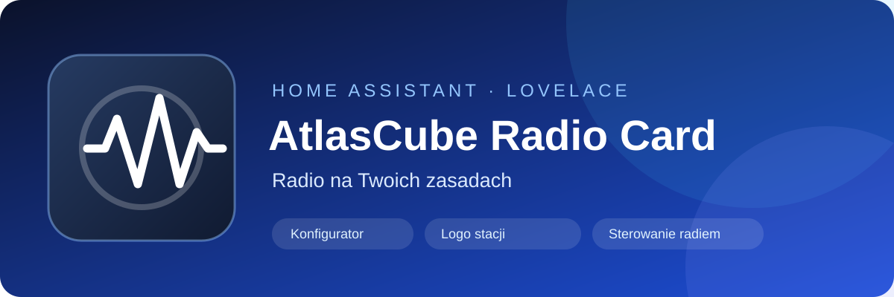

# AtlasCube Radio Card

A compact, modern Home Assistant Lovelace card for AtlasCube radio devices.

> **Version 0.5.0 — candidate for final verification**
>
> This version brings the tested local station-logo library into the official card package. The main branch remains unchanged until review and verification are complete.

---

## 🇬🇧 English

### Features

- Automatic detection of the AtlasCube device and its entities
- No hard-coded AtlasCube device name required
- Compact Previous / Play-Stop / Next controls
- Large central Play/Stop button
- Optional album artwork with artist, title and album information
- Station name and current track information
- Source selector
- Volume slider and mute control
- Dynamic online/offline state
- Rainbow radio animation while playing
- Wi-Fi-off indicator when the device is offline
- Automatically opens the AtlasCube web interface from the Home Assistant device configuration_url
- Uses the native MQTT availability state propagated by Home Assistant
- Does not require a separate ping sensor
- Optional manual availability override
- Optional album artwork, source and volume sections
- Ordered station-logo search, local disk cache and manual selection

### Requirements

- Home Assistant
- AtlasCube radio integrated into Home Assistant
- AtlasCube entities available through the MQTT integration
- HACS is recommended for installation

The card discovers the AtlasCube device from the Home Assistant device/entity registries instead of depending on a fixed entity naming scheme.

### Installation with HACS

Install this repository through HACS as a **custom repository of type Integration**:

1. Open HACS → three-dot menu → **Custom repositories**.
2. Add `MarLip1981/atlascube-radio-card` and select **Integration**.
3. Install **AtlasCube Radio Card**.
4. Restart Home Assistant.
5. Open Settings → Devices & services → **Add integration** and add **AtlasCube Local Logos**.
6. Refresh the Home Assistant frontend. The integration serves the bundled card JavaScript and registers it automatically; do not add a manual Lovelace resource.

This is the same installation model used by the tested local-logo package. The integration and the bundled JavaScript must be kept in sync; the repository includes both copies. If the old test integration is installed, remove it before installing this official package to avoid duplicate websocket handlers and frontend resources.

### Automatic configuration

After adding the card to a dashboard, open the card editor and use:

**Automatically detect AtlasCube**

The editor detects the AtlasCube device and fills the main entity fields automatically:

- Station
- Track title
- Playback state
- Volume
- Source
- Previous
- Play
- Stop
- Next

The Availability field is optional and should normally remain empty.

### MQTT availability

AtlasCube exposes its availability through MQTT. Home Assistant processes this availability information and applies it to the native AtlasCube entities.

The card therefore uses the state of the native AtlasCube entities as the frontend representation of MQTT availability:

- normal entity state → AtlasCube online
- `unavailable` / `unknown` → AtlasCube offline

A separate `binary_sensor` ping helper is not required.

A manually selected availability entity can still be configured as an explicit override when needed.

### Web interface

Clicking the card header opens the AtlasCube web interface.

The address is obtained automatically from the AtlasCube device `configuration_url`.

You do not need to enter the device IP address manually.

### Manual YAML configuration

    type: custom:atlascube-radio-card

    radio:
      station: sensor.atlascube_radio_stacja_radiowa
      title: sensor.atlascube_radio_tytul_utworu
      playback: sensor.atlascube_9140_playback
      volume: number.salon_atlascube_radio_glosnosc
      source: select.atlascube_9140_source
      previous: button.atlascube_9140_previous
      play: button.atlascube_9140_play
      stop: button.atlascube_9140_stop
      next: button.atlascube_9140_next
      # availability: optional manual override

    show_artwork: true
    show_source: true
    show_volume: true

### Album artwork

Album artwork is optional and can be enabled or disabled in the card editor.

When enabled and the radio is playing, the card uses the current `Artist - Title` metadata to search the iTunes Search API, caches the result and displays a 200×200 cover with a subtle 18 px blurred background. When the radio is stopped, the artwork and track information are hidden while the blurred background is retained.

When artwork is disabled, the card returns to the compact radio presentation with the animated rainbow radio icon while playing.

### Status indicators

| Indicator | Meaning |
|---|---|
| Radio icon | Online and stopped |
| Rainbow radio icon | Online and playing |
| Wi-Fi-off icon | AtlasCube unavailable/offline |

### Manual installation

Download `atlascube-radio-card.js` from this repository and add it as a Lovelace JavaScript resource.

---

## 🇵🇱 Polski

### Funkcje

- Automatyczne wykrywanie urządzenia AtlasCube i jego encji
- Brak zależności od konkretnej nazwy urządzenia
- Kompaktowe przyciski Poprzednia / Play-Stop / Następna
- Duży centralny przycisk Play/Stop
- Opcjonalne okładki utworów z wykonawcą, tytułem i albumem
- Nazwa stacji i tytuł aktualnego utworu
- Wybór źródła
- Suwak głośności i wyciszenie
- Dynamiczny stan online/offline
- Tęczowa animacja radia podczas odtwarzania
- Ikona Wi-Fi-off, gdy AtlasCube jest niedostępny
- Automatyczne otwieranie panelu WWW AtlasCube na podstawie `configuration_url` urządzenia Home Assistant
- Wykorzystanie natywnej dostępności MQTT obsługiwanej przez Home Assistant
- Brak potrzeby tworzenia osobnego sensora ping
- Opcjonalny ręczny override dostępności
- Opcjonalne okładki, sekcje źródła i głośności
- Uporządkowane wyszukiwanie logo stacji, lokalny cache na dysku i ręczny wybór

### Wymagania

- Home Assistant
- Radio AtlasCube dodane do Home Assistant
- Encje AtlasCube dostępne przez integrację MQTT
- Zalecane HACS

Karta wykrywa urządzenie na podstawie rejestru urządzeń i encji Home Assistant. Nie zakłada jednej, sztywnej nazwy urządzenia ani adresu IP.

### Instalacja przez HACS

Zainstaluj repozytorium przez HACS jako **niestandardowe repozytorium typu Integration**:

1. Otwórz HACS → menu trzech kropek → **Niestandardowe repozytoria**.
2. Dodaj `MarLip1981/atlascube-radio-card` i wybierz typ **Integration**.
3. Zainstaluj **AtlasCube Radio Card**.
4. Uruchom ponownie Home Assistant.
5. Otwórz Ustawienia → Urządzenia i usługi → **Dodaj integrację** i dodaj **AtlasCube Local Logos**.
6. Odśwież frontend Home Assistant. Integracja sama udostępnia dołączony plik JavaScript karty i automatycznie rejestruje zasób Lovelace — nie dodawaj go ręcznie.

To ten sam sposób instalacji, który działał w testowym pakiecie z lokalnymi logo. Integracja i dołączony plik JavaScript muszą być aktualizowane razem; w repozytorium znajdują się obie kopie. Jeśli masz zainstalowaną wcześniejszą integrację testową, usuń ją przed instalacją oficjalnego pakietu, aby uniknąć zdublowanych obsług websocket i zasobów frontendowych.

### Automatyczna konfiguracja

Po dodaniu karty do dashboardu otwórz jej edytor i użyj:

**Automatycznie wykryj AtlasCube**

Edytor automatycznie wyszukuje urządzenie AtlasCube i przypisuje główne encje:

- stacja
- tytuł utworu
- stan odtwarzania
- głośność
- źródło
- poprzednia
- play
- stop
- następna

Pole Dostępność powinno normalnie pozostać puste.

### Dostępność MQTT

AtlasCube przekazuje dostępność przez MQTT. Home Assistant przetwarza tę informację i uwzględnia ją w stanach natywnych encji AtlasCube.

Karta wykorzystuje więc stan encji jako reprezentację dostępności MQTT:

- normalny stan encji → AtlasCube online
- `unavailable` / `unknown` → AtlasCube offline

Nie trzeba tworzyć `binary_sensor.192_168_1_6` ani żadnego innego sensora ping.

Pole dostępności pozostaje dostępne jako ręczny override, jeśli w konkretnej instalacji będzie potrzebny.

### Panel WWW AtlasCube

Kliknięcie nagłówka karty otwiera panel WWW AtlasCube.

Adres jest pobierany automatycznie z `configuration_url` urządzenia Home Assistant.

Nie trzeba wpisywać adresu IP ręcznie.

### Konfiguracja YAML

    type: custom:atlascube-radio-card

    radio:
      station: sensor.atlascube_radio_stacja_radiowa
      title: sensor.atlascube_radio_tytul_utworu
      playback: sensor.atlascube_9140_playback
      volume: number.salon_atlascube_radio_glosnosc
      source: select.atlascube_9140_source
      previous: button.atlascube_9140_previous
      play: button.atlascube_9140_play
      stop: button.atlascube_9140_stop
      next: button.atlascube_9140_next
      # availability: opcjonalny ręczny override

    show_source: true
    show_volume: true

### Okładki utworów

Okładki utworów można włączyć lub wyłączyć w edytorze karty.

Po włączeniu, podczas odtwarzania karta wyszukuje okładkę na podstawie metadanych `Artysta - Tytuł`, zapamiętuje wynik i pokazuje okładkę 200×200 px z delikatnie rozmytym tłem 18 px. Po zatrzymaniu radia okładka i informacje o utworze są ukrywane, ale rozmyte tło pozostaje.

Po wyłączeniu okładek karta wraca do kompaktowego widoku radia z tęczową animacją podczas odtwarzania.

### Wskaźniki stanu

| Wskaźnik | Znaczenie |
|---|---|
| Ikona radia | Online i zatrzymane |
| Tęczowa ikona radia | Online i odtwarzanie |
| Ikona Wi-Fi-off | AtlasCube niedostępny/offline |

### Instalacja ręczna

Pobierz `atlascube-radio-card.js` z tego repozytorium i dodaj go jako zasób JavaScript Lovelace.

---

## Screenshots

### Card in Home Assistant

### Card configuration editor

### Additional card views

## Development status

**v0.5.0 release candidate**

This candidate retains the established radio controls and adds the station-logo workflow. It is not a published release until the integration installation path, automated checks, and Home Assistant behavior have been verified.

- AtlasCube auto-discovery
- optional album artwork
- native MQTT-derived availability
- automatic web interface discovery
- online/offline card behavior
- local station-logo cache and selection
- ordered automatic logo search with fallback

Brightness, LED ring, SD card and URL playback controls remain intentionally outside the default card.

## HACS publication checklist

- [x] Public GitHub repository
- [x] `hacs.json`
- [x] Dashboard/plugin repository structure
- [x] License
- [x] README documentation
- [x] HACS validation workflow
- [x] Real screenshots in README
- [ ] GitHub repository description
- [ ] GitHub repository topics
- [ ] Verify GitHub Issues are enabled
- [ ] Create the first GitHub Release
- [ ] Run and pass HACS validation
- [x] Submit repository to the HACS default `plugin` list (PR #11557 accepted)

The repository has already been accepted into the default HACS repository list (PR #11557). Before publishing v0.5.0, validate the final branch and resolve the companion-integration installation limitation described above. The banner is embedded in this README; the SVG icon is a repository asset and is not claimed to be a native HACS icon field.

## License

MIT License — see [LICENSE](LICENSE).

## Repository

`MarLip1981/atlascube-radio-card`
